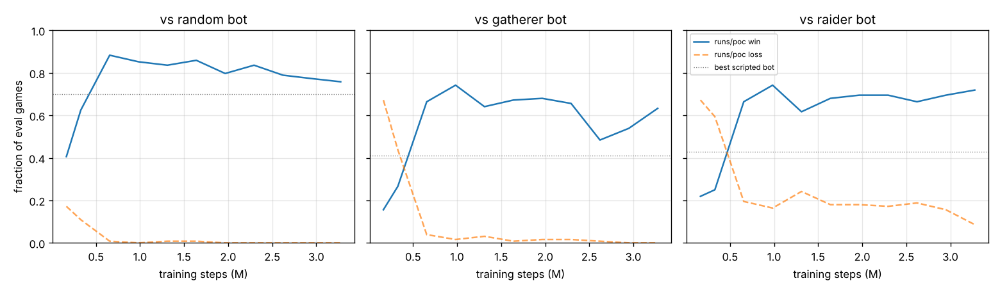
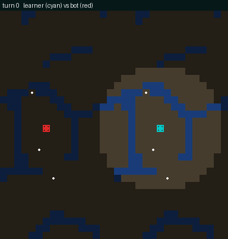

# AI Ants: CPU proof-of-concept training

A first baseline showing the aiants env is learnable with a convolutional
gridnet policy. Plain PyTorch PPO on CPU, outside PufferLib's CUDA trainer,
against fixed scripted opponents. It is not a tuned or final setup.

## Pieces

- `aiants_vec.c`: ctypes binding running N games in parallel (OpenMP), with
  the same env code as `ocean/aiants/aiants.h`. Agent slot 0 is the
  learner; slot 1 is a scripted bot that only uses its own fog-of-war view.
  - `random`: uniform moves.
  - `gatherer`: walks toward the nearest visible food.
  - `raider`: gatherer that also attacks visible enemy hills and nearby ants.
- `train.py`: GridNet policy, PPO, evaluation, bot-vs-bot baselines.
- `replay.py`: renders a game of a trained model vs a bot to a GIF.
- `plot.py`: learning curves from `log.csv`.

## Policy: GridNet (~62k params)

- Input: 9 observation planes plus 4 globals broadcast as planes (13 x 32 x 32).
- Space-to-depth folds 2x2 cells into channels, so every conv runs at 16x16:
  - 4 wrap-around 3x3 convs (the map is a torus), residual;
  - an 8x8 branch with a global-context vector, added back.
- Pixel-shuffle unfolds a 1x1 conv head into 5 logits per cell, masked by
  the env's action mask.
- Value comes from mean+max pooled features.
- The action log-probability is the sum over cells (only cells with own
  ants have more than one legal action). Entropy is reported per ant.

CPU speed notes (4-core VM with AMX bf16):
- bf16 autocast plus channels-last is about 3x faster than fp32.
- Hand-written circular padding is about 3x faster than
  `padding_mode='circular'`.
- Space-to-depth is about 2x faster than full-resolution convs.
- Gumbel-max sampling is about 8x faster than `torch.distributions.Categorical`.

End to end: about 1,100 training steps/s (rollout + 2 PPO epochs).

## Usage

```bash
pip install torch --index-url https://download.pytorch.org/whl/cpu
pip install numpy matplotlib pillow
python3 ocean/aiants/train/train.py --baselines --eval_games 200
python3 ocean/aiants/train/train.py --steps 6_000_000 --run runs/poc
python3 ocean/aiants/train/plot.py runs/poc --out curves.png
python3 ocean/aiants/train/replay.py runs/poc/model.pt --bot gatherer --out replay.gif
```

The shared library is (re)built automatically into `build/libaiants.so`.

## Results

Reference: scripted bots against each other (`--baselines`, 200 games each,
win / draw / loss from the learner-side bot's view):

| learner side \ opponent | random | gatherer | raider |
|---|---|---|---|
| random | .24 / .49 / .26 | .15 / .14 / .70 | .16 / .14 / .70 |
| gatherer | .70 / .14 / .17 | .33 / .38 / .29 | .34 / .29 / .37 |
| raider | .70 / .16 / .14 | .41 / .30 / .29 | .43 / .24 / .33 |

### Training run

Command: `train.py --steps 8_000_000 --run runs/poc` with the defaults:
- 128 games, horizon 32, 2 epochs x 4 minibatches;
- Adam, lr 1e-3, gamma 0.99, lambda 0.95, entropy 0.003;
- rewards: win 1, score 0.1, food 0.1, kill 0.02;
- opponents: the three bots round-robin.

I stopped it at 3.3M steps (about 1 hour of compute) because it had
plateaued since about 1M.



Final policy (`assets/gridnet_poc.pt`), 256 fresh games per bot:

| vs | win | draw | loss | mean length |
|---|---|---|---|---|
| random | 0.74 | 0.26 | 0.00 | 217 |
| gatherer | 0.59 | 0.40 | 0.00 | 325 |
| raider | 0.73 | 0.17 | 0.10 | 212 |

Greedy (argmax) actions are similar or slightly worse (0.72 / 0.48 / 0.73
wins).

The policy:
- beats every scripted bot well above the best bot's own win rate against
  it (0.70 / 0.41 / 0.43) and almost never loses;
- learned to expand quickly, spread out to cover the map and out-gather
  the bot, then grind down its ants (see `assets/replay_vs_raider.gif`);
- rarely finishes by razing the hill, so most non-wins are draws at the
  turn limit or rank cutoff, especially against the defensive gatherer.



### What I learned getting here

- With the env's default shaping (food 0.01) the signal was almost all
  the sparse, game-end ±1, shared across about 10 ants. After normalizing
  advantages, PPO saw mostly noise and the entropy bonus pushed the
  policy back toward uniform. Raising food reward to 0.1 and lowering
  gamma to 0.99 gave learning within about 300k steps.
- Batch 64 inference takes a CPU oneDNN path about 4x slower than batch
  128, which made evaluation dominate the run until I changed it.

### Next steps

- **Finishing games:** hill-raze shaping, or a longer horizon and gamma
  once the policy is competent, to turn the draws into wins.
- **Selfplay:** train against snapshots of itself instead of fixed bots.
- **PufferLib trainer on a GPU:** port GridNet as a custom
  encoder/decoder (`src/ocean.cu` hooks, like `nmmo3`). It needs only
  space-to-depth, wrap-padded 3x3 convs and pixel-shuffle.
- **Map size:** the net is fully convolutional, so it transfers to other
  grid sizes (16/64) as long as the size is divisible by 4.

